# head_analysis 文件关系图

```mermaid
graph TB
    subgraph Docs["📄 文档"]
        DESIGN["DESIGN.md<br/>设计文档"]
        SURVEY["KV_Cache_Survey.md<br/>文献综述"]
    end

    subgraph Probe["🔍 观测层 (Probe) — 采集注意力数据"]
        PSEUDO["analyze_heads_pseudo.py<br/>伪查询头分析"]
        SPARSE["sparsemm_style.py<br/>答案窗口命中分析"]
        RF["temporal_receptive_field.py<br/>时间感受野"]
        CT_HIT["hit_counting.py<br/>CT题token命中"]
        CHUNK["chunk_hit.py<br/>Chunk级命中"]
        CHUNK_LABEL["chunk_label_hit.py<br/>自标注chunk命中"]
        PEAK["peak_counting.py<br/>峰值检测"]
        PREV_CUR["obs_prev_current_chunk_attention.py<br/>手动attention: prev vs chunk"]
        PREV_CUR_E["obs_prev_current_chunk_attention_eager.py<br/>eager attention: prev vs chunk"]
        MEM_READOUT["profile_effective_memory_readout.py<br/>答案端记忆读出打分"]
        MEM_SELECTOR["profile_internal_memory_selector.py<br/>内部记忆选择器评估"]
        SANITY["eager_attention_sanity_check.py<br/>手动/eager一致性校验"]
    end

    subgraph Taxonomy["🏷️ 分类层 (Taxonomy) — 聚合+分类"]
        PROCESS["process_heads.py<br/>raw_obs → head_scores.npz"]
        AGGREGATE["aggregate_prev_current_to_kv_heads.py<br/>query heads → KV heads聚合"]
        BUILD_KV["build_kv_head_classes.py<br/>KV head角色分类"]
        BUILD_CTX["build_context_head_classes.py<br/>head_classes.json"]
        BUILD_BUDGET["build_memory_core_budget_scores.py<br/>budget score CSV"]
    end

    subgraph Policy["⚙️ 策略层 (Policy) — 异构驱逐"]
        HEAD_BUDGET["hermes_head_budget.py<br/>per-head投票+预算分配"]
        KV_HEAD_BUDGET["hermes_kv_head_budget.py<br/>per-KV-head预算+mask"]
        LAYER_BUDGET["hermes_layer_budget.py<br/>层自适应预算"]
        ROLEKV1["rolekv_policy.py<br/>RoleKV v1: dense投票"]
        ROLEKV2["rolekv_ragged_policy.py<br/>RoleKV v2: ragged配额"]
        RAGGED["hermes_kv_head_ragged.py<br/>decode-only ragged cache"]
        RAGGED_PF["hermes_kv_head_ragged_prefill.py<br/>ragged prefill/chunk"]
        CTX_DENIAL["context_denial.py<br/>attention mask消融"]
    end

    subgraph Viz["📊 可视化"]
        VIS["visualize.py<br/>head score热力图"]
        HEATMAP["obs_heatmap.py<br/>时间偏好热力图"]
        STABILITY["obs_stability.py<br/>跨视频稳定性"]
        WRONG_EV["obs_wrong_eviction_equal_len.py<br/>wrong-policy消融"]
        ARTIFACTS["generate_prev_current_profile_artifacts.py<br/>prev/current分析图"]
        PLOT_READOUT["plot_effective_readout_attention.py<br/>记忆读出曲线"]
        PLOT_TOPK["plot_memory_core_topk_attention.py<br/>top-K注意力对比"]
        PLOT_TOKEN["plot_token_readout_attention.py<br/>token位置读出分布"]
    end

    subgraph Run["🚀 运行入口"]
        RUN_ANALYSIS["run_analysis.py<br/>Probe A/B对比"]
        RUN_BUDGET["run_head_budget.py<br/>head budget实验"]
        RUN_ROLEKV["run_rolekv_subset.py<br/>RoleKV v1评估"]
        RUN_ROLEKV_R["run_rolekv_ragged_subset.py<br/>RoleKV v2评估"]
        RUN_ONE["run_rolekv_one_video.py<br/>单视频smoke test"]
        RUN_DENIAL["run_context_denial_ablation.py<br/>上下文阻断消融"]
        SUMMARIZE["summarize_rolekv_subset.py<br/>RoleKV结果汇总"]
    end

    subgraph Shell["📜 Shell Wrappers"]
        SH_RUN["run.sh"]
        SH_PSEUDO["run_pseudo.sh"]
        SH_HIT["run_hit.sh"]
        SH_HIT_CT["run_hit_ct.sh"]
        SH_CHUNK["run_chunk.sh"]
        SH_CHUNK_L["run_chunk_label.sh"]
        SH_RF["run_rf.sh"]
        SH_BUDGET["run_head_budget.sh"]
    end

    %% 数据流
    PSEUDO -->|raw_obs.csv| PROCESS
    PREV_CUR -->|raw_prev_current.csv| ARTIFACTS
    PREV_CUR_E -->|head_profile_scores.csv| AGGREGATE
    MEM_READOUT -->|effective_readout_scores.csv| BUILD_BUDGET
    MEM_SELECTOR -->|selector_scores.csv| BUILD_BUDGET
    SANITY -.->|校验| PREV_CUR

    PROCESS -->|head_scores.npz| HEAD_BUDGET
    PROCESS -->|head_scores.npz| VIS
    PROCESS -->|head_scores.npz| HEATMAP
    PROCESS -->|head_scores.npz| STABILITY
    AGGREGATE -->|kv_head_profile.csv| BUILD_KV
    BUILD_KV -->|head_classes.json| ROLEKV1
    BUILD_KV -->|head_classes.json| ROLEKV2
    BUILD_KV -->|head_classes.json| CTX_DENIAL
    BUILD_CTX -->|head_classes.json| CTX_DENIAL
    BUILD_BUDGET -->|budget_scores.csv| KV_HEAD_BUDGET
    BUILD_BUDGET -->|budget_scores.csv| LAYER_BUDGET

    HEAD_BUDGET --> KV_HEAD_BUDGET
    KV_HEAD_BUDGET --> LAYER_BUDGET
    KV_HEAD_BUDGET --> RAGGED
    RAGGED --> RAGGED_PF
    ROLEKV2 --> RAGGED_PF

    %% 运行入口
    RUN_ANALYSIS --> PSEUDO
    RUN_BUDGET --> HEAD_BUDGET
    RUN_ROLEKV --> ROLEKV1
    RUN_ROLEKV_R --> ROLEKV2
    RUN_DENIAL --> CTX_DENIAL
    SUMMARIZE --> RUN_ROLEKV
    SUMMARIZE --> RUN_ROLEKV_R

    %% Shell
    SH_RUN --> RUN_ANALYSIS
    SH_PSEUDO --> PSEUDO
    SH_HIT --> SPARSE
    SH_HIT_CT --> CT_HIT
    SH_CHUNK --> CHUNK
    SH_CHUNK_L --> CHUNK_LABEL
    SH_RF --> RF
    SH_BUDGET --> RUN_BUDGET

    %% Style
    classDef probe fill:#e1f5fe,stroke:#0288d1
    classDef taxonomy fill:#fff3e0,stroke:#f57c00
    classDef policy fill:#e8f5e9,stroke:#388e3c
    classDef viz fill:#fce4ec,stroke:#c62828
    classDef run fill:#ede7f6,stroke:#4527a0
    classDef shell fill:#f5f5f5,stroke:#616161
    classDef doc fill:#fff9c4,stroke:#f9a825

    class PSEUDO,SPARSE,RF,CT_HIT,CHUNK,CHUNK_LABEL,PEAK,PREV_CUR,PREV_CUR_E,MEM_READOUT,MEM_SELECTOR,SANITY probe
    class PROCESS,AGGREGATE,BUILD_KV,BUILD_CTX,BUILD_BUDGET taxonomy
    class HEAD_BUDGET,KV_HEAD_BUDGET,LAYER_BUDGET,ROLEKV1,ROLEKV2,RAGGED,RAGGED_PF,CTX_DENIAL policy
    class VIS,HEATMAP,STABILITY,WRONG_EV,ARTIFACTS,PLOT_READOUT,PLOT_TOPK,PLOT_TOKEN viz
    class RUN_ANALYSIS,RUN_BUDGET,RUN_ROLEKV,RUN_ROLEKV_R,RUN_ONE,RUN_DENIAL,SUMMARIZE run
    class SH_RUN,SH_PSEUDO,SH_HIT,SH_HIT_CT,SH_CHUNK,SH_CHUNK_L,SH_RF,SH_BUDGET shell
    class DESIGN,SURVEY doc
```



## 核心数据流

```
┌─────────────────────────────────────────────────────────────┐
│  📄 DESIGN.md  ← 设计蓝图  ←  KV_Cache_Survey.md           │
└─────────────────────────────────────────────────────────────┘
                              │
                              ▼
┌──────────────────────────────────────────────────────────────┐
│  🔍 观测层: 多种探针独立采集各头的注意力行为                   │
│                                                              │
│  伪查询:     analyze_heads_pseudo.py  ──→ raw_obs.csv        │
│  答案窗口:   sparsemm_style.py                               │
│  感受野:     temporal_receptive_field.py                     │
│  CT命中:     hit_counting.py / chunk_hit.py                  │
│  prev/chunk: obs_prev_current_chunk_attention.py/eager.py    │
│  记忆读出:   profile_effective_memory_readout.py             │
│  内部选择:   profile_internal_memory_selector.py             │
│  校验:       eager_attention_sanity_check.py                 │
└──────────────────────────────────────────────────────────────┘
                              │
                              ▼
┌──────────────────────────────────────────────────────────────┐
│  🏷️ 分类层: 聚合+量化 → 形成头分类                           │
│                                                              │
│  process_heads.py  →  head_scores.npz (shift, early ratio)   │
│  aggregate_prev_current_to_kv_heads.py  →  KV粒度聚合         │
│  build_kv_head_classes.py  →  memory / current / mixed       │
│  build_context_head_classes.py  →  head_classes.json         │
│  build_memory_core_budget_scores.py  →  budget_score.csv     │
└──────────────────────────────────────────────────────────────┘
                              │
                              ▼
┌──────────────────────────────────────────────────────────────┐
│  ⚙️ 策略层: 依据头分类设计异构驱逐                             │
│                                                              │
│  异构预算:     hermes_head_budget.py                         │
│              → hermes_kv_head_budget.py                      │
│              → hermes_layer_budget.py                        │
│  角色投票:     rolekv_policy.py (v1, dense)                  │
│              → rolekv_ragged_policy.py (v2, ragged)          │
│  物理ragged:   hermes_kv_head_ragged.py                      │
│              → hermes_kv_head_ragged_prefill.py              │
│  消融验证:     context_denial.py (attention mask阻断)         │
│              → obs_wrong_eviction_equal_len.py               │
└──────────────────────────────────────────────────────────────┘

三个阶段严格顺序依赖:
  观测 → 分类 → 策略
  每个阶段可以独立迭代，只要输出格式不变
```
